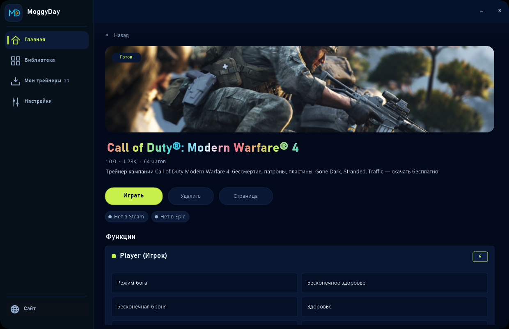
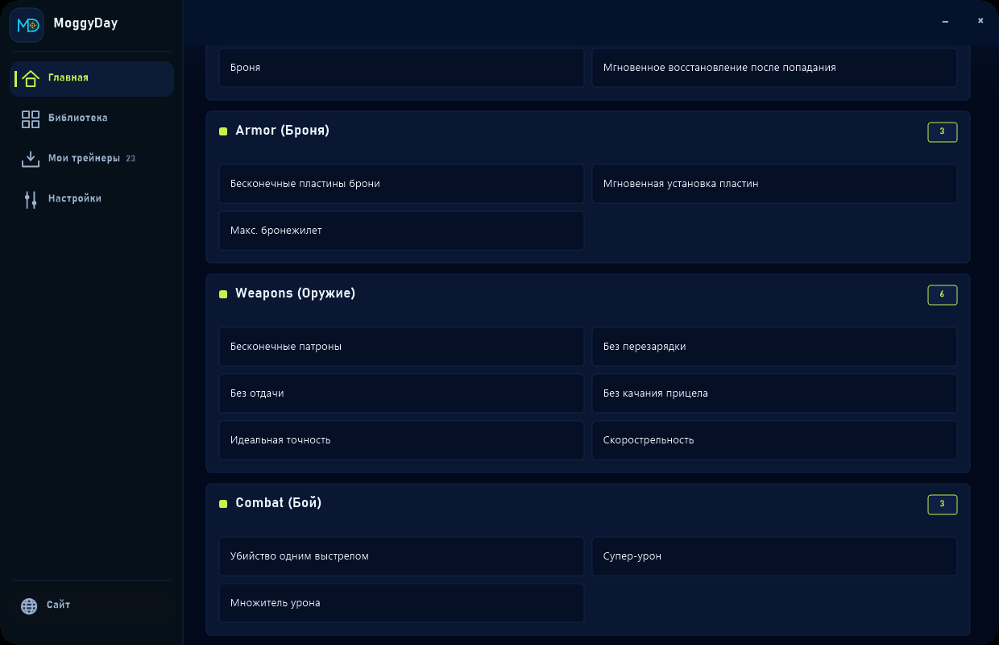
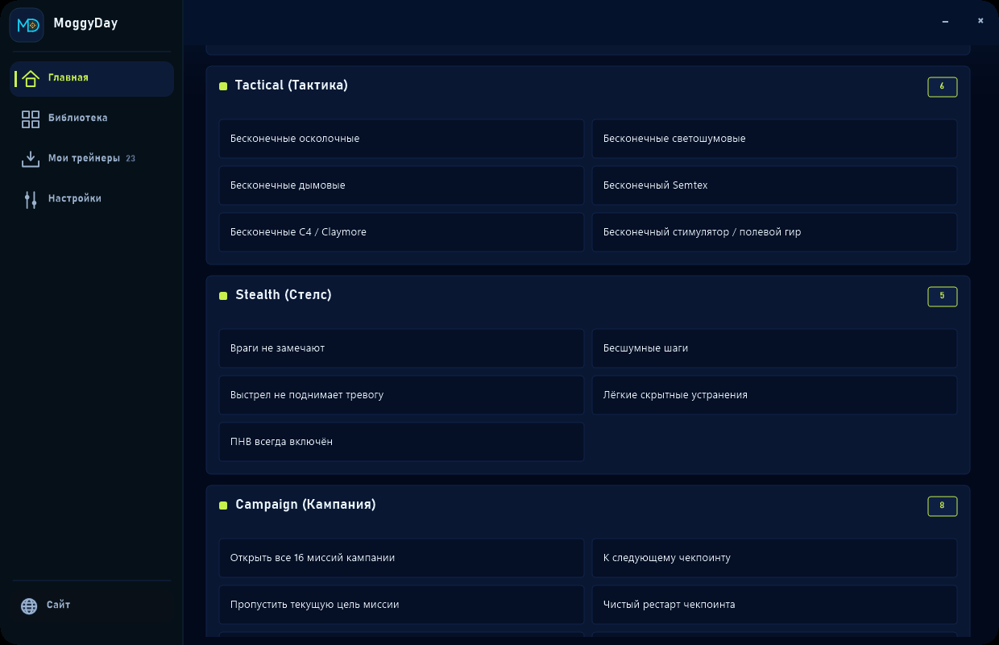
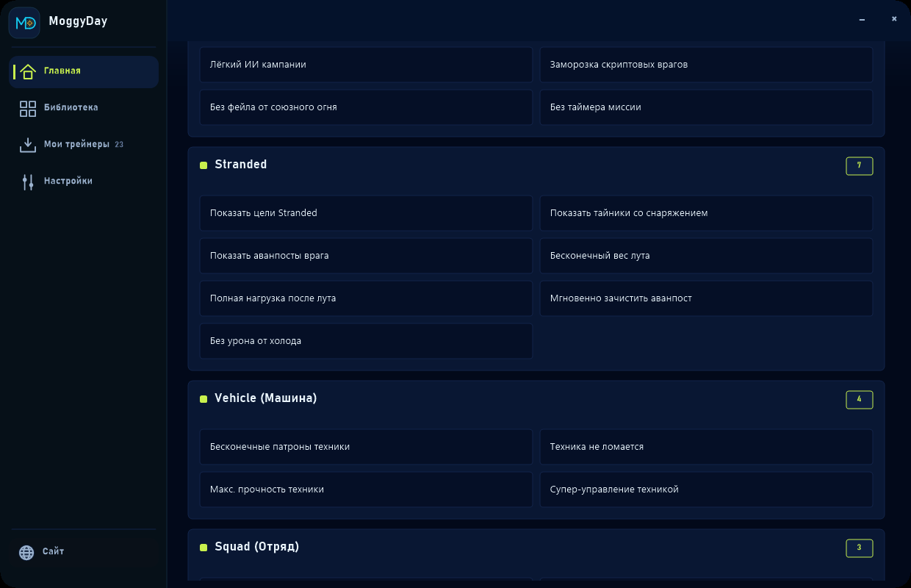
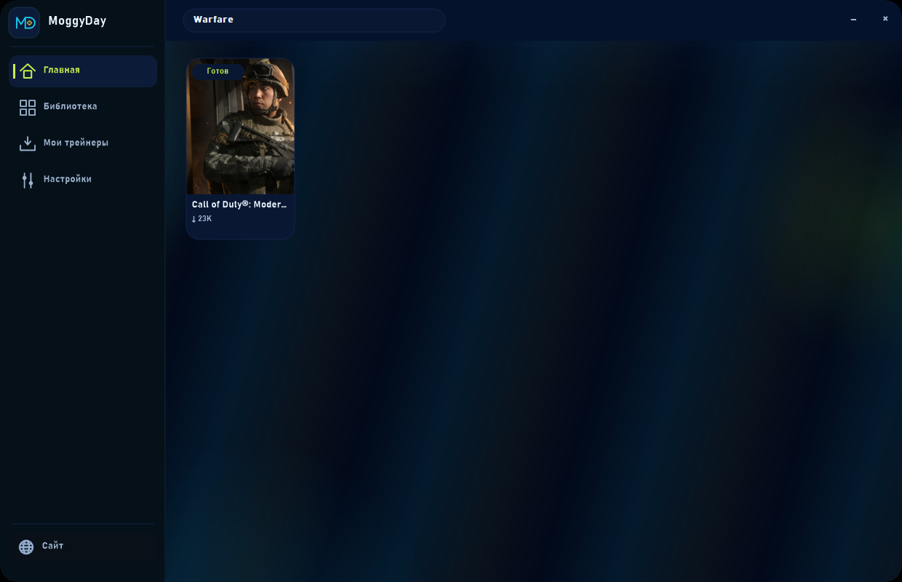

[ZH 中文](README.zh.md) · [ES Español](README.es.md) · [PT-BR Português](README.pt-BR.md) · [DE Deutsch](README.de.md) · [FR Français](README.fr.md) · [TR Türkçe](README.tr.md) · [PL Polski](README.pl.md) · [IT Italiano](README.it.md) · [KO 한국어](README.ko.md) · [JA 日本語](README.ja.md) · [VI Tiếng Việt](README.vi.md) · [ID Indonesia](README.id.md) · [AR العربية](README.ar.md) · [UK Українська](README.uk.md) · [RU Русский](README.ru.md) · [EN English](README.en.md)

## Screenshots

**EN:** <https://moggydaytrainer.com/en/f/call-of-duty-modern-warfare-4-trainer> · **RU:** <https://moggydaytrainer.com/f/call-of-duty-modern-warfare-4-trainer> · **ZH:** <https://moggydaytrainer.com/zh/f/call-of-duty-modern-warfare-4-trainer>

# Call of Duty Modern Warfare 4 Trainer +64 kostenlos download 2026 — Gottmodus, unendlich Munition, kein Rückstoß

MoggyDay-Spiegel für den **Call of Duty Modern Warfare 4 Trainer**. +64 Optionen, **aktueller Steam-Patch**. Keine .exe in diesem Repo.

Steam AppID **4435490**. 16 Kampagnen-Missionen (Korea, New York, Paris, Mumbai, Stranded). Kein Multiplayer, kein RICOCHET.

### Beliebte Funktionen

- Gottmodus / unendlich Leben
- Unendlich Munition
- Kein Rückstoß
- Kein Nachladen
- One-Hit-Kill
- Unendlich Sprint
- Kampagne freischalten
- Aktueller Patch

### Kostenlos downloaden

1. Offizielle URL öffnen
2. Domain moggydaytrainer.com prüfen
3. Free download klicken
4. Nach einem Patch dieselbe URL neu laden

### Aktueller Patch

Der **Call of Duty Modern Warfare 4 Trainer** bleibt auf dem live Steam-Build.

Nur Kampagne / offline / custom. Nicht Ranked.

**Offizieller Download:** <https://moggydaytrainer.com/en/f/call-of-duty-modern-warfare-4-trainer>

### FAQ

**Kostenlos?**  
Ja, nur bei MoggyDay.

**Aktueller Patch?**  
Ja.

**.exe hier?**  
Nein.

`Call of Duty Modern Warfare 4 Trainer, Call of Duty Modern Warfare 4 Cheats, kostenlos download, Gottmodus, kein Rückstoß, 2026`
